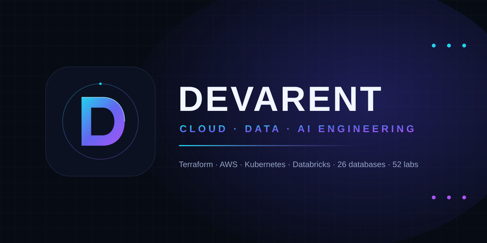

<div align="center">
  
</div>

# Repo Atlas — Cloud & Data Control Center

Versi Next.js dari katalog repo. Menggantikan halaman HTML statis di `repo-atlas/`.

## Identitas visual

Logo baru memakai monogram **AF** geometris dengan gradasi cyan → indigo → violet di atas latar navy. Aset:

| File | Dipakai untuk |
| --- | --- |
| `assets/avatar-512.png` | **GitHub profile avatar** — unggah lewat Settings → Profile → Avatar |
| `assets/social-preview.png` | **Social preview** repo — unggah lewat Settings → Social preview |
| `assets/brand-logo.svg` | Logo vektor di dashboard dan README |
| `assets/brand-banner.svg` | Banner lebar untuk README |

> GitHub tidak menyediakan API publik untuk mengganti avatar/social preview, jadi dua unggahan di atas harus lewat UI Settings. Semua file sudah tersedia di repo ini dan di `devarent/devarent/assets/`.

## Stack

- **Next.js 16** (App Router) + **React 19** + **TypeScript**
- **Tailwind CSS v4** (`@tailwindcss/postcss`)
- **shadcn-style UI** di atas **Radix UI**: Tabs, Dialog, Tooltip, Separator, Slot
- `class-variance-authority`, `clsx`, `tailwind-merge`, `lucide-react`

## Jalankan

```bash
cd C:\laragon\www\repo-atlas-next
npm install
npm run dev          # http://localhost:3100
npm run build        # verifikasi produksi
```

## UX (shadcn-style)

- Sidebar navigasi tetap + topbar dengan pencarian global (`Ctrl+K`), theme toggle dark/light, dan tautan GitHub.
- Daftar repo bisa dua mode: **grid kartu** atau **tabel sortable** (Julukan, Repository, Trek, Jenis, Bahasa).
- Toast konfirmasi untuk setiap aksi salin (URL, perintah SSH, clone, runbook).
- Panel akses ganda: **localhost** (`http://localhost:3100`) dan **IP publik EC2** (`http://<Elastic_IP>`).
- Dialog detail repo dengan tombol salin `git clone`.

## Deploy ke localhost / IP publik

```bash
# Lokal
npm run dev                     # http://localhost:3100

# Docker lokal
docker compose up -d --build    # http://localhost:3000

# EC2 + Elastic IP (butuh kredensial AWS valid)
bash scripts/deploy-all.sh      # dari WSL 2 Ubuntu
# hasil: http://<PUBLIC_IP>
```

Artefak deploy: `Dockerfile` (multi-stage standalone), `docker-compose.yml`, `.github/workflows/deploy.yml` (GHCR → SSH EC2), dan `terraform/main.tf` (EC2 + EIP + security group).

## Isi dashboard

| Tab | Isi |
| --- | --- |
| **Atlas Repo** | 52 repo @devarent, 9 konstelasi negara, filter trek/jenis, pencarian, dialog detail. |
| **26 Database** | 7 Relasional/distributed SQL · 8 Cloud analytics · 4 NoSQL/search · 3 Vector/graph · 4 Streaming/time-series. |
| **Cloud & Runbook** | 10 stack (WSL2, EC2, Terraform, Docker, K8s/Helm, Actions, Databricks, Keras, Route53/AC/CloudFront, Prometheus/Grafana). Panel koneksi EC2 + 6 runbook dengan tombol salin. |
| **Roadmap & Role** | 9 fase belajar + 4 peran dengan repo pembuktian. |
| **Referensi** | 19 tautan resmi (UI, Cloud, IaC, Kubernetes, Data, Belajar). |

Ctrl+K membuka pencarian global lintas repo, database, dan referensi.

## Keamanan

- **Tidak ada** Access Key, Secret Key, atau IP publik palsu yang disimpan di kode.
- Panel "Koneksi EC2" hanya menyimpan **IP, region, dan user SSH** di `localStorage` browser (untuk membentuk perintah SSH).
- Jalankan `aws login` atau isi `aws configure` dengan kredensial asli di WSL 2 sebelum `terraform apply`.
- Jalankan `terraform destroy` setelah selesai agar EIP/EC2 tidak ditagih.

## Sumber data

- `lib/data/repos.ts` — di-generate dari `repo-atlas/atlas-data.js` oleh `scripts/gen-repos.mjs`.
- `lib/data/databases.ts` — 26 teknologi data sesuai permintaan.
- `lib/data/cloud.ts` — stack, runbook, referensi, roadmap, role fit.

Jika daftar repo berubah:

```bash
node scripts/gen-repos.mjs
```
